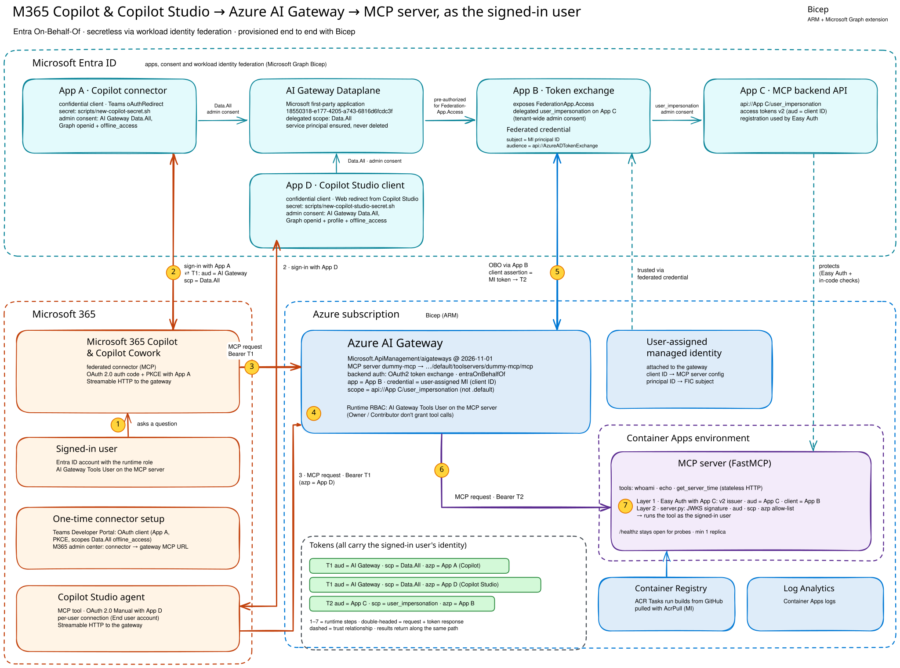

# Microsoft 365 Copilot / Copilot Cowork → Azure AI Gateway → MCP server, as the signed-in user

Terraform that provisions, end to end:

- **Microsoft Entra ID** (`azuread`): the MCP backend API, the gateway's *token exchange* app with a
  secretless federated credential, the Copilot connector client app, pre-authorizations, and
  tenant-wide admin consent.
- **Azure Container Apps** (`azurerm`): a dummy FastMCP server protected twice by the backend app
  registration: Container Apps built-in auth (Easy Auth), then in-code JWT validation.
- **Azure AI Gateway** (`azapi`, `Microsoft.ApiManagement/aigateways@2026-11-01`): a gateway with a
  user-assigned managed identity, and an MCP server whose backend uses **Entra On-Behalf-Of** to
  call the container as the user.

> The Bicep version of this setup, with the Entra objects deployed through the Microsoft Graph Bicep
> extension, is on the [`main`](https://github.com/kostapetan/ai-gateway-end-to-end/tree/main) branch.



Step by step, one tool call looks like this:


The full walkthrough (token-by-token table and why each piece exists) is in
**[docs/architecture.md](docs/architecture.md)**. Diagram sources (`.excalidraw`) and PNGs are in
[`docs/diagrams/`](docs/diagrams/).

## What gets created

| Where | Object | Purpose |
| --- | --- | --- |
| Entra | **App A** `<prefix>-copilot-connector` | OAuth 2.0 client for the M365 Copilot federated connector: `Data.All` (AI Gateway), `openid`, `offline_access`, admin consent, client secret |
| Entra | **App B** `<prefix>-token-exchange` | Exposes `FederationApp.Access` (AI Gateway app pre-authorized). Delegated `user_impersonation` on App C with admin consent. Federated credential trusting the gateway's managed identity |
| Entra | **App C** `<prefix>-mcp-backend` | MCP backend API: `api://<id>/user_impersonation`, v2 tokens, App B pre-authorized |
| Entra | AI Gateway Dataplane service principal (`18550318-…`) | Created if missing; never deleted on destroy |
| Azure | User-assigned managed identity, attached to the gateway | Authenticates as App B (no secret) |
| Azure | AI Gateway + MCP server `dummy-mcp` | Backend auth: `oauth2` / `tokenExchange` / `entraOnBehalfOf` |
| Azure | Role assignment **AI Gateway Tools User** on the MCP server | Runtime permission to call tools (Owner and Contributor don't grant this) |
| Azure | ACR (image built with `az acr build`), Container Apps environment + app, Log Analytics | Hosts the dummy MCP server |

## Prerequisites

- Azure CLI signed in to the target tenant (`az login --tenant <tenant-id>`) as a user who can
  create app registrations and grant tenant-wide admin consent (we used Global Administrator), and
  who is Owner of the subscription (role assignments are created).
- Terraform ≥ 1.9 and Python 3, used by the end-to-end test.
- Docker (optional): only used if ACR Tasks can't build the image.
- A region where AI Gateway is available, for example `swedencentral`, `westeurope`, `eastus2`
  (validated in `variables.tf`).

## Deploy

```bash
cd infra
cp terraform.tfvars.example terraform.tfvars   # set subscription_id (and optionally location, name_prefix)
terraform init
terraform apply
```

Roughly 5 minutes. Outputs include the gateway MCP endpoint, for example
`https://aigw-….swedencentral-01.ai.gateway.azure.com/default/toolservers/dummy-mcp/mcp`.

## Verify the OBO chain

```bash
python3 scripts/test-obo.py
```

The script gets your delegated gateway token from the Azure CLI (`https://ai.gateway.azure.com/Data.All`,
the same audience and scope Copilot's token has). It then runs MCP `initialize`, `tools/list`, and
`dummy_whoami` through the gateway, and checks what the backend actually received:

```text
[3] initialize -> protocol 2025-11-25, server Azure AI Gateway
[4] tools/list -> ['dummy_echo', 'dummy_get_server_time', 'dummy_whoami']
[5] dummy_whoami -> { "username": "admin@contoso.onmicrosoft.com", "audience": "<App C>", "client_app_id": "<App B>", "scopes": "user_impersonation", ... }
[6] Gateway token sent straight to the backend -> HTTP 401

PASS  anonymous gateway call is rejected (401)
PASS  backend saw the signed-in user (oid)
PASS  backend token audience is the backend app
PASS  backend token was requested by the token exchange app (azp)
PASS  backend token carries the delegated scope
PASS  backend rejects tokens that bypass the gateway
```

## Connect Microsoft 365 Copilot / Copilot Cowork

Terraform creates App A and its consent. The Teams Developer Portal registration and the connector
are portal steps:

```bash
terraform -chdir=infra output copilot_connector                  # all values below
terraform -chdir=infra output -raw copilot_connector_client_secret
```

1. **Teams Developer Portal** (<https://dev.teams.microsoft.com/tools>), signed in to **the same tenant**:
   **Tools → OAuth client registration → New**. Paste the values without leading or trailing spaces.

   | Field | Value |
   | --- | --- |
   | Base URL | `base_url`, the gateway MCP endpoint. Must match the connector's Base URL exactly |
   | Restrict usage by org | My organization only |
   | Restrict usage by app | **Any Teams app** (binding a Teams app ID breaks MCP calls) |
   | Client ID / Client secret | `client_id` / `copilot_connector_client_secret` |
   | Authorization endpoint | `authorization_endpoint` |
   | Token endpoint and Refresh endpoint | `token_endpoint` |
   | Scopes | `https://ai.gateway.azure.com/Data.All offline_access` |
   | PKCE | Enabled |

   Save, then copy the **OAuth client registration ID**.
2. **Microsoft 365 admin center** → **Copilot → Connectors → Gallery → Create a new connector →
   Connect to MCP server**. Set **Base URL** to the gateway MCP endpoint and **Authentication** to
   **OAuth 2.0** (not Microsoft Entra SSO), and paste the registration ID. Save, open it from
   **Your connections**, and select **Sign in** under **Tools**.
3. **Grant users runtime access.** Add their object IDs, or a group's, to
   `runtime_access_principal_ids` and run `terraform apply`. Without the role, the gateway returns 403.
4. Ask Copilot something like *"Using the dummy MCP tools, who am I?"*. `dummy_whoami` returns the
   identity the backend received through OBO.

Copilot connects with OAuth 2.0 rather than Entra SSO because Entra SSO would require changing the
AI Gateway's first-party app registration, which you can't do.

## Optional: GitHub Copilot in VS Code

`terraform apply` writes `.vscode/mcp.json` for the gateway endpoint. The gateway doesn't publish
OAuth discovery metadata (no `WWW-Authenticate` challenge, and `/.well-known/oauth-protected-resource`
returns 404), so VS Code can't run the Entra sign-in itself. It prompts for a token instead. Paste the
output of:

```bash
az account get-access-token --scope https://ai.gateway.azure.com/Data.All --query accessToken -o tsv
```

The token is valid for roughly 60–90 minutes.

## Lessons and gotchas

- **Toolserver schema for `2026-11-01`:** use `toolServerType` (not `type`), endpoint
  `mode: failClosed|failOpen` (not `required`), `mcp.endpoint.url` (not `mcp.url`), and
  `authentication.oauth2` (not `credentials`). The older preview shape fails with *"Tool server type
  must be a supported value."*
- **OBO settings:** `scopes` must be explicit delegated scopes (`api://<App C>/user_impersonation`);
  `/.default` is rejected. `appCredential.clientId` is the managed identity's **client** ID, while the
  federated credential's subject is its **principal** ID.
- **Token exchange app:** it exposes `FederationApp.Access` with the AI Gateway app
  (`18550318-e177-4205-a743-6816d6fcdc3f`) as a pre-authorized client, and holds
  admin-consented delegated permission on App C.
- **Backend tokens:** v2 tokens carry `aud` = App C's client ID (a GUID), issuer
  `login.microsoftonline.com/<tenant>/v2.0`, and `azp` = App B. Both Easy Auth
  (`allowedApplications`) and `server.py` allow-list App B, so the backend can't be called directly.
- **Protocol versions:** the gateway advertises only versions the backend supports. The default is
  `2025-11-25`, `2025-06-18`, `2025-03-26`; Copilot proposes `2025-11-25`.
- **Gateway user token:** clients request `https://ai.gateway.azure.com/Data.All`. A missing token or
  scope returns HTTP 401 with *"Missing or invalid Entra ID token, or missing Data.All scope."*
- **azurerm 5.x:** the Container Apps environment needs `logs_destination = "log-analytics"`. Declare
  the default `Consumption` workload profile to avoid a perpetual diff.

## Troubleshooting

| Symptom | Likely cause and fix |
| --- | --- |
| Gateway 401 *"missing Data.All scope"* | The token is for another audience. Request `https://ai.gateway.azure.com/Data.All` (or `.default` for app-only). |
| Gateway 403 | The caller lacks **AI Gateway Tools User** on the MCP server. Add them to `runtime_access_principal_ids`. |
| Tool call fails and the backend logs show no request | OBO failed: check the federated credential subject, the pre-authorization on App B, and the App B → App C consent. App B's service principal sign-in logs in Entra show the error. |
| Backend 401 with `WWW-Authenticate: Bearer realm=…` | Easy Auth rejected the token (audience, issuer, or client app). Set `enable_easy_auth = false` to isolate the in-code checks. |
| Backend logs `Rejected token: client app (azp) … is not allow-listed` | The token wasn't obtained by App B. |
| `tools/list` returns 502 or JSON-RPC `-32603` | MCP version mismatch. Adjust `mcp_protocol_versions`. |
| 400 / `-32602` *"Required MCP request metadata is missing"* | Only `2026-07-28` is enabled. Keep the `2025-*` versions. |
| Copilot: *"Selected user account does not exist in tenant"* | Signed in to a different tenant than the gateway and the apps. |
| Copilot: sign-in fails with zero requests at the gateway | The Teams Developer Portal registration is in another tenant, or its Base URL doesn't exactly match the connector's. |

## Clean up

```bash
terraform -chdir=infra destroy
```

Then delete the Teams Developer Portal OAuth registration and the M365 connector by hand. The AI
Gateway Dataplane service principal is intentionally left in the tenant.

> Terraform state contains the Copilot connector client secret. Use a secured remote backend for
> anything beyond a lab. To rotate the secret, run
> `terraform apply -replace='azuread_application_password.copilot_connector[0]'` and update the Teams
> Developer Portal registration.

## Layout

```text
infra/            Terraform root module
  entra.tf          App B + App C, federated credential, pre-authorizations, admin consent
  copilot_connector.tf  App A for the M365 Copilot federated connector
  ai_gateway.tf     AI Gateway, MCP server (OBO backend), runtime role assignment
  mcp_server.tf     ACR, image build, Container Apps environment + app, Easy Auth
  main.tf           Resource group and managed identities
  clients.tf        .vscode/mcp.json for GitHub Copilot in VS Code
  scripts/          ensure-service-principal.sh, build-image.sh
mcp-server/       FastMCP server (whoami, echo, get_server_time) + Dockerfile
scripts/test-obo.py   End-to-end OBO verification
docs/             architecture.md + diagrams/ (Excalidraw sources, SVG, PNG)
```
